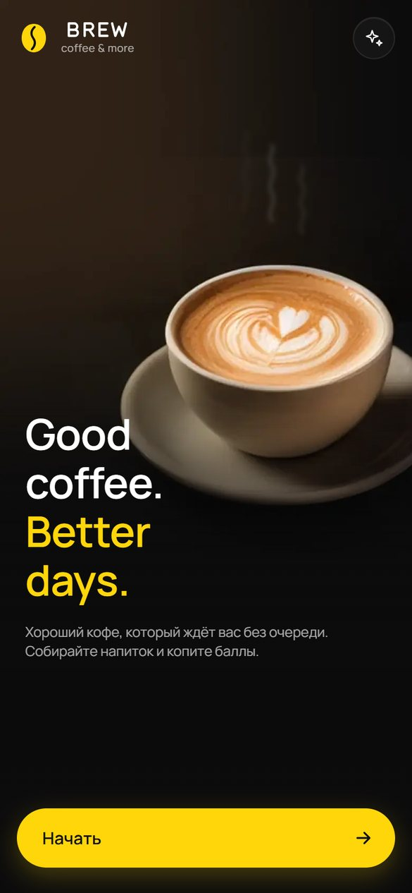
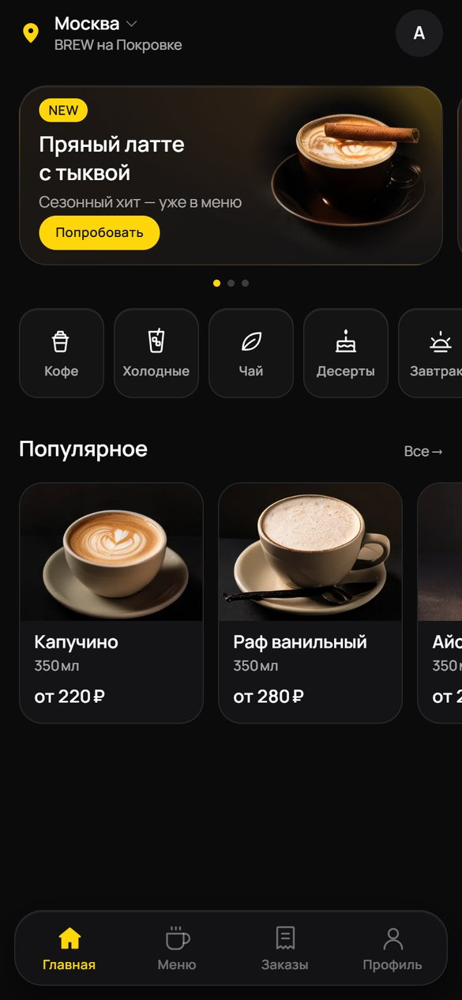
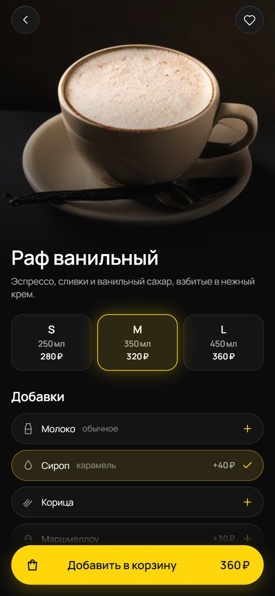
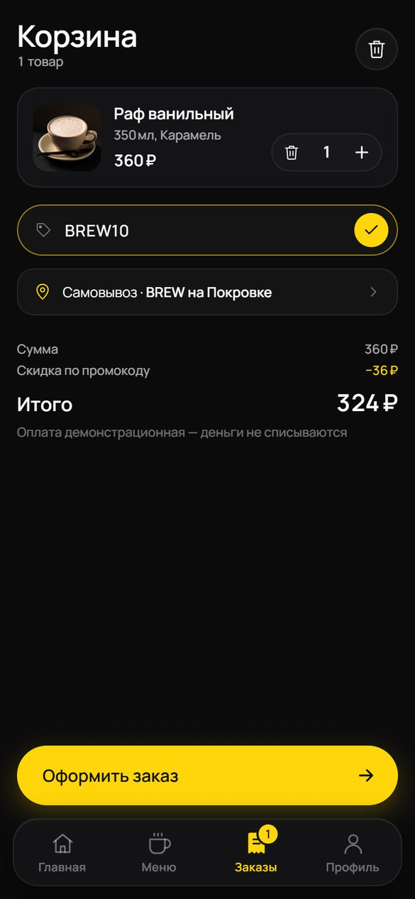
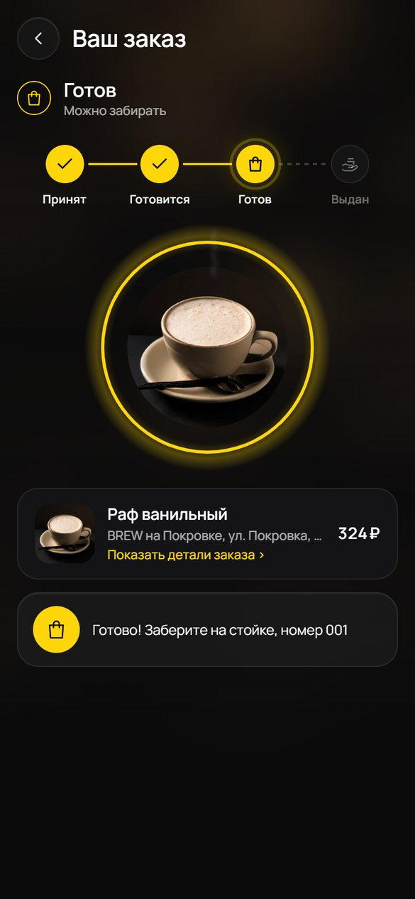
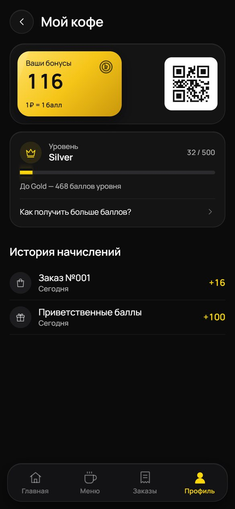
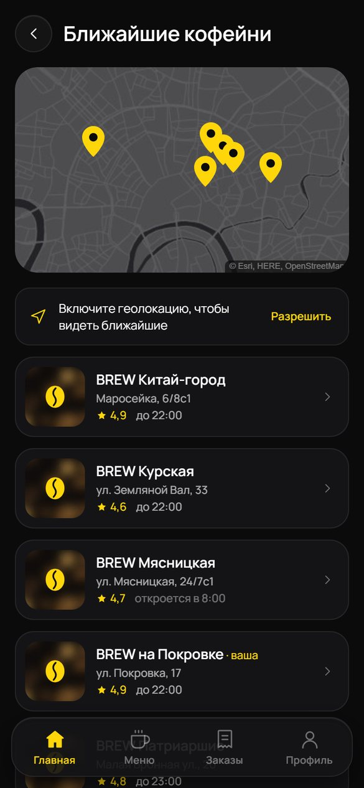
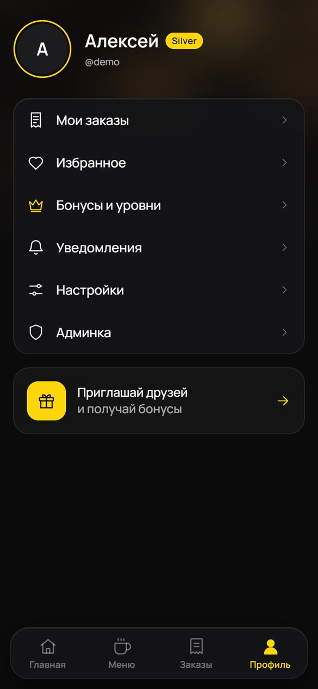

# BREW coffee & more — Telegram-бот кофейни с Mini App

Демо-проект для портфолио: бот кофейни, в котором можно выбрать напиток, собрать заказ, «оплатить» его
и следить за статусом в реальном времени. Внутри — Mini App в тёмном премиальном стиле с плавной анимацией
(рассчитана на 60 FPS на ПК и до 120 FPS на iPhone с ProMotion), бонусная карта, карта кофеен, AI-бариста и админка.

  
  
  
  

  
  
  
  

> Оплата ненастоящая: деньги не списываются, это экран-имитация.

---

## ⬇️ Скачать и запустить (Windows 10/11)

**[Скачать BREW-Bot-Windows.zip](https://github.com/forrerin/zerno-coffee-bot/releases/latest/download/BREW-Bot-Windows.zip)**

Больше ничего ставить не нужно — ни Python, ни Node.js.

1. Распакуйте архив и дважды кликните **`BREW Bot.exe`**.
   Если Windows покажет «Система Windows защитила ваш компьютер» — нажмите **«Подробнее» → «Выполнить в любом случае»**
   (программа не подписана платным сертификатом).
2. В окне программы вставьте **токен своего бота**. Получить его просто: в Telegram откройте
   [@BotFather](https://t.me/BotFather), отправьте `/newbot`, придумайте имя — BotFather пришлёт токен.
3. Дождитесь пяти зелёных галочек и надписи **«Всё работает!»**, нажмите **«Открыть бота в Telegram»** → `/start`.
   Mini App открывается кнопкой **«Меню»** слева от поля ввода.

Бот работает, пока открыто окно программы. Рядом с программой появятся `config.env` (ваш токен — хранится
только у вас) и папка `BREW-data` (база и логи).

## 👆 Что попробовать

- **Заказ:** выберите напиток, размер и добавки → «Добавить в корзину» → промокод **`BREW10`** → «Оформить заказ».
  Статус меняется сам: Принят → Готовится → Готов, бот пишет об этом в чат.
- **Мой кофе:** бонусная карта с QR-кодом для кассира, уровень Silver → Gold, история начислений (5% с заказа).
- **Ближайшие кофейни:** тёмная карта, нажмите на кофейню — карта перелетит к ней, ещё раз — откроется карточка.
- **AI-бариста:** напишите боту, например, «хочу что-то холодное и не сладкое».
- **Админка:** «Профиль → Админка» — заказы в реальном времени, меню, промокоды, рассылки, статистика.

## ❓ Если что-то не так

| Что видно в окне | Что сделать |
|---|---|
| «Telegram не принял токен» | Скопируйте токен из @BotFather ещё раз целиком |
| «Нет связи с Telegram» | Проверьте интернет; если Telegram у вас работает только через VPN — включите VPN |
| Не горит «HTTPS-доступ для Telegram» | Бесплатный туннель иногда подключается со второй попытки — программа пробует сама. Бот уже работает, Mini App пока откроется кнопкой «Mini App в браузере» |
| Антивирус ругается на .exe | Ложное срабатывание на неподписанную программу — добавьте в исключения |

## Что внутри

- **Mini App:** 8 экранов — онбординг, главная, карточка товара, корзина, статус заказа, «Мой кофе», профиль,
  ближайшие кофейни; скелетоны, пустые состояния, ошибки, офлайн-режим
- **Дизайн-система BREW:** тёмный интерфейс, жёлтый акцент, «стеклянные» поверхности, Manrope, токены цвета,
  типографики, радиусов и моушена
- **Моушен:** shared element «карточка → товар», полёт товара в корзину по дуге, перекат цифр в ценах,
  кольцо статуса с бликом, пар над чашкой, пружинные переходы; всё — только `transform`/`opacity`
  на композиторе, с поддержкой «Уменьшить движение» и lite-режимом для слабых телефонов
- **Telegram:** нативная кнопка «Назад», полноэкранный режим, safe areas, haptic feedback,
  CloudStorage, геолокация, подтверждение закрытия при непустой корзине
- **Бот:** заказы, уведомления о статусе, AI-бариста, напоминания, рассылки, антиспам
- **Безопасность:** проверка подписи Telegram `initData`, цена всегда пересчитывается на сервере

**Технологии:** Python (aiogram 3, FastAPI, SQLAlchemy), React 19 + TypeScript + Vite, Leaflet.

## Исходный код

Исходный код закрыт. Программа собрана компилятором Nuitka в нативный код — внутри нет исходников Python.
По вопросам сотрудничества и доступа к коду — откройте Issue в этом репозитории.

© 2026 forrerin. Все права защищены — см. [LICENSE](LICENSE).
